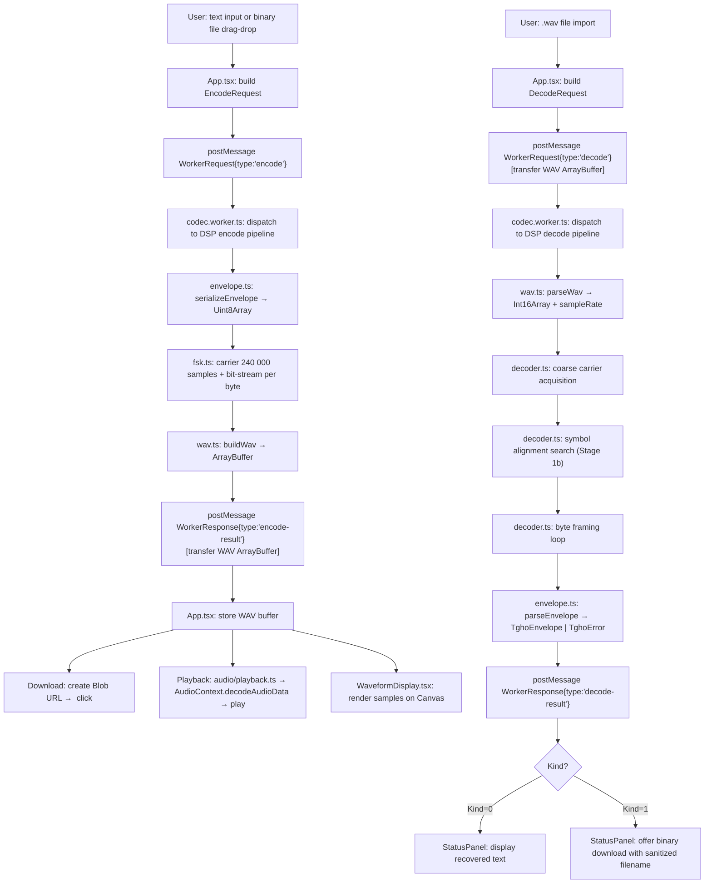

# Design Document

## Overview

TapeGhost is a browser-only educational application that encodes text or binary files into KCS-derived FSK audio, exports a WAV file, and recovers the original bytes through a full decode pipeline with CRC-32/ISO-HDLC integrity verification.

The architecture separates concerns into four zones:

1. **`src/dsp/`** — pure TypeScript codec modules with zero browser globals, fully testable in Node.js
2. **`src/workers/codec.worker.ts`** — Web Worker host that wraps the DSP modules, providing progress reporting and cancellation
3. **`src/audio/`** — Web Audio API playback, main thread only
4. **`src/components/`** — React UI components, main thread only

The signal format is KCS-derived 300-baud FSK (1200 Hz = logic zero, 2400 Hz = logic one) with 8N2 character framing, carrying a TGHO application-layer envelope. All codec parameters are frozen in the dsp-correctness steering document and must not be changed without a recorded design decision.

---

## Architecture

### Module Boundaries

```
┌────────────────────────────────────────────────────────────────┐
│  Browser Main Thread                                           │
│                                                                │
│  ┌──────────────────┐      ┌────────────────────────────────┐ │
│  │  src/components/ │      │  src/audio/                    │ │
│  │  React UI        │      │  AudioContext, play/stop       │ │
│  │  - CassetteCtrl  │      │  playback.ts                   │ │
│  │  - WaveformDisp  │      └────────────────────────────────┘ │
│  │  - BitInspector  │                    ▲                     │
│  │  - StatusPanel   │                    │ decoded WAV buffer  │
│  │  App.tsx         │                    │                     │
│  └──────────┬───────┘                    │                     │
│             │ WorkerRequest              │                     │
│             ▼                            │                     │
│  ┌──────────────────────────────────┐   │                     │
│  │  Worker boundary (postMessage)   │   │                     │
│  └──────────────────┬───────────────┘   │                     │
│                     │ WorkerResponse    │                     │
│                     │ (progress/result) │                     │
└─────────────────────┼───────────────────┼─────────────────────┘
                      │                   │
┌─────────────────────▼───────────────────┘─────────────────────┐
│  Web Worker (codec.worker.ts)                                  │
│                                                                │
│  ┌──────────────────────────────────────────────────────────┐ │
│  │  src/dsp/  (pure TypeScript, no browser globals)         │ │
│  │                                                          │ │
│  │  envelope.ts  ←→  crc32.ts                               │ │
│  │       ↑                                                  │ │
│  │  framing.ts   ←→  fsk.ts  ←→  wav.ts                    │ │
│  │       ↑                          ↑                       │ │
│  │  decoder.ts                  errors.ts                   │ │
│  │       ↑                                                  │ │
│  │  index.ts  (public DSP API re-exports)                   │ │
│  └──────────────────────────────────────────────────────────┘ │
└────────────────────────────────────────────────────────────────┘
```

### Data Flow Diagram



---

## Components and Interfaces

### TypeScript Type Definitions

#### Error Types

```typescript
// All error categories as a discriminated union.
// Each tag maps to exactly one named error condition in Requirements 8.6.

export type TghoError =
  | { readonly kind: 'oversized-file'; readonly byteCount: number }
  | { readonly kind: 'unsupported-wav-profile'; readonly detail: string }
  | { readonly kind: 'no-carrier' }
  | { readonly kind: 'sync-failure' }
  | { readonly kind: 'framing-error' }
  | { readonly kind: 'magic-mismatch' }
  | { readonly kind: 'unsupported-version'; readonly version: number }
  | { readonly kind: 'unknown-kind'; readonly value: number }
  | { readonly kind: 'filename-length-overflow'; readonly length: number }
  | { readonly kind: 'payload-length-overflow'; readonly length: number }
  | { readonly kind: 'truncation' }
  | { readonly kind: 'crc-mismatch' }
  | { readonly kind: 'utf8-encoding-error' }
  | { readonly kind: 'filename-in-text-envelope' }
  | { readonly kind: 'internal-error'; readonly detail: string };
```

#### Envelope Types

```typescript
export const TGHO_KIND_TEXT = 0 as const;
export const TGHO_KIND_BINARY = 1 as const;
export type TghoKind = typeof TGHO_KIND_TEXT | typeof TGHO_KIND_BINARY;

export interface TghoEnvelope {
  readonly version: 1;
  readonly kind: TghoKind;
  /** Raw UTF-8 bytes of the filename; empty Uint8Array for Kind=0 */
  readonly filenameBytes: Uint8Array;
  /** Raw payload bytes */
  readonly payloadBytes: Uint8Array;
}
```

#### Encode Types

```typescript
export interface EncodeOptions {
  /** Sample rate for the output WAV. Only 48000 is supported for encoding. */
  readonly sampleRate: 48000;
}

export interface EncodeRequest {
  readonly kind: TghoKind;
  /** Raw payload bytes; max 1024 */
  readonly payloadBytes: Uint8Array;
  /** Raw UTF-8 filename bytes; empty for Kind=0, max 64 for Kind=1 */
  readonly filenameBytes: Uint8Array;
  readonly options: EncodeOptions;
}

export interface EncodeResult {
  /** Complete RIFF/WAVE file as a transferable ArrayBuffer */
  readonly wavBuffer: ArrayBuffer;
  /** Audio duration in seconds (= 5 + envelopeBytes * 11 / 300) */
  readonly durationSeconds: number;
  /** Total serialized envelope byte count including CRC */
  readonly envelopeByteCount: number;
}
```

#### Decode Types

```typescript
export interface DecodeRequest {
  /** Raw WAV file bytes as a transferable ArrayBuffer */
  readonly wavBuffer: ArrayBuffer;
}

export type DecodeSuccess = {
  readonly ok: true;
  readonly kind: TghoKind;
  readonly payloadBytes: Uint8Array;
  readonly filenameBytes: Uint8Array;
  /** Always true on success; CRC was verified before this result is produced */
  readonly crcVerified: true;
};

export type DecodeFailure = {
  readonly ok: false;
  readonly error: TghoError;
};

export type DecodeResult = DecodeSuccess | DecodeFailure;
```

#### Worker Message Protocol

```typescript
export interface WorkerEncodeRequest {
  readonly type: 'encode';
  readonly id: string;
  readonly payload: EncodeRequest;
}

export interface WorkerDecodeRequest {
  readonly type: 'decode';
  readonly id: string;
  readonly payload: DecodeRequest;
}

export interface WorkerCancelRequest {
  readonly type: 'cancel';
  readonly id: string;
}

export type WorkerRequest =
  | WorkerEncodeRequest
  | WorkerDecodeRequest
  | WorkerCancelRequest;

// --- Responses ---

export interface WorkerProgressResponse {
  readonly type: 'progress';
  readonly id: string;
  readonly percent: number; // 0–100
  readonly stage: string;   // e.g. 'carrier', 'encoding byte 42 of 128', 'parsing envelope'
}

export interface WorkerEncodeResultResponse {
  readonly type: 'encode-result';
  readonly id: string;
  readonly result: EncodeResult;
  /** Wall-clock ms measured inside the worker with performance.now() */
  readonly wallClockMs: number;
}

export interface WorkerDecodeResultResponse {
  readonly type: 'decode-result';
  readonly id: string;
  readonly result: DecodeResult;
  /** Wall-clock ms measured inside the worker with performance.now() */
  readonly wallClockMs: number;
}

export interface WorkerErrorResponse {
  readonly type: 'error';
  readonly id: string;
  readonly error: TghoError;
}

export interface WorkerCancelledResponse {
  readonly type: 'cancelled';
  readonly id: string;
}

export interface WorkerBusyResponse {
  readonly type: 'busy';
  readonly id: string;
}

export type WorkerResponse =
  | WorkerProgressResponse
  | WorkerEncodeResultResponse
  | WorkerDecodeResultResponse
  | WorkerErrorResponse
  | WorkerCancelledResponse
  | WorkerBusyResponse;
```

#### WAV Parsed Data

```typescript
export interface WavData {
  readonly samples: Int16Array;
  readonly sampleRate: 44100 | 48000;
}
```

#### Symbol Classification

```typescript
// Three-way result from the frequency classifier. Distinguishes strong signals
// from ambiguous ones; 'ambiguous' during data framing triggers a framing-error.
export type SymbolClass = 'one' | 'zero' | 'ambiguous';
```

#### DSP Function Signatures (no implementation)

```typescript
// src/dsp/crc32.ts
export function crc32(bytes: Uint8Array): number;

// src/dsp/envelope.ts
export function serializeEnvelope(env: TghoEnvelope): Uint8Array;
export function parseEnvelope(bytes: Uint8Array): TghoEnvelope | TghoError;

// src/dsp/fsk.ts
export function writeBitInto(
  bit: 0 | 1,
  phase: number,
  dest: Int16Array,
  offset: number,
  sampleRate: 48000
): number; // returns nextPhase
// Writes exactly samplesPerBit (160) samples into dest starting at offset.
// No allocation; dest is the pre-allocated output buffer.

// src/dsp/wav.ts
export function buildWav(samples: Int16Array, sampleRate: 48000): ArrayBuffer;
export function parseWav(buffer: ArrayBuffer): WavData | TghoError;

// src/dsp/framing.ts
export function byteToFrameBits(byte: number): ReadonlyArray<0 | 1>;
// Returns 11 bits: [start=0, b0, b1, b2, b3, b4, b5, b6, b7, stop=1, stop=1]

export function frameBitsToByte(bits: ReadonlyArray<0 | 1>): number | null;
// Returns null if start bit ≠ 0 or either stop bit ≠ 1

// src/dsp/decoder.ts
// All decoder stage functions are pure and synchronous; the worker handles
// cancellation and yielding externally by calling these functions between chunks.

export function classifyBitPeriod(
  samples: Int16Array,
  startSample: number,
  samplesPerBit: number,
  sampleRate: 44100 | 48000
): SymbolClass;
// Bounds check first: if startSample + samplesPerBit > samples.length → 'ambiguous'.
// Quadrature correlator with two target frequencies; returns 'one', 'zero', or 'ambiguous'.

export function acquireCarrier(
  samples: Int16Array,
  sampleRate: 44100 | 48000
): { carrierEndSample: number } | TghoError;
// Stage 1: coarse scan for ≥900 consecutive logic-one bit-periods of 2400 Hz.
// Returns { carrierEndSample } on success, { kind: 'no-carrier' } on failure.

export function alignSymbols(
  samples: Int16Array,
  carrierEndSample: number,
  sampleRate: 44100 | 48000
): { dataBitOffset: number } | TghoError;
// Stage 1b: scan all samplesPerBit candidate offsets after carrierEndSample,
// validating each against the TGHO magic bytes (0x54 0x47 0x48 0x4F).
// Returns { dataBitOffset } on success, { kind: 'sync-failure' } on failure.

export function frameByte(
  samples: Int16Array,
  currentOffset: number,
  sampleRate: 44100 | 48000
): { byte: number; nextOffset: number } | TghoError;
// Stage 3: frame a single byte — start bit, 8 data bits (LSB-first), 2 stop bits.
// Returns { byte, nextOffset } on success, or a TghoError ('framing-error' or 'truncation').

// Full synchronous pipeline for unit testing. Calls the stages in sequence with
// no cancellation; the worker orchestrates the stages externally for live use.
export function decodeWav(wavData: WavData): DecodeResult;

// src/dsp/errors.ts
export function formatError(err: TghoError): string;
// Returns a human-readable message for display in the StatusPanel

// src/dsp/index.ts
// Re-exports all public symbols from the above modules
```

---

## Data Models

### TGHO Envelope — Frozen Wire Contract

The byte layout is frozen. Any change requires a new version number and a recorded design decision. Implementations must not deviate from this table.

| Offset | Size (bytes) | Field | Encoding |
|--------|-------------|-------|----------|
| 0 | 4 | Magic | ASCII `TGHO` — 0x54 0x47 0x48 0x4F |
| 4 | 1 | Version | `uint8`, value `1` |
| 5 | 1 | Kind | `uint8`: `0` = UTF-8 text, `1` = binary file |
| 6 | 2 | Filename Length | `uint16` little-endian, range 0–64 |
| 8 | 4 | Payload Length | `uint32` little-endian, range 0–1024 |
| 12 | FL | Filename | UTF-8 bytes, count = Filename Length |
| 12 + FL | PL | Payload | raw bytes, count = Payload Length |
| 12 + FL + PL | 4 | CRC | `uint32` little-endian, CRC-32/ISO-HDLC over bytes 0..(12+FL+PL-1) |

- Fixed header = 12 bytes
- Minimum total envelope = 16 bytes (empty payload, no filename)
- Maximum total envelope = 12 + 64 + 1024 + 4 = 1104 bytes

### CRC-32/ISO-HDLC Parameters

| Parameter | Value |
|-----------|-------|
| Polynomial | 0x04C11DB7 (reflected: 0xEDB88320) |
| Initial value | 0xFFFFFFFF |
| Input reflected | yes |
| Output reflected | yes |
| Final XOR | 0xFFFFFFFF |
| Known-answer test | CRC-32/ISO-HDLC of ASCII `123456789` = `0xCBF43926` |

The CRC is error detection only. It does not correct errors, encrypt data, or establish authenticity.

### FSK Signal Parameters

| Parameter | Value |
|-----------|-------|
| Baud rate | 300 symbols/second |
| Logic zero | 1200 Hz, 4 complete cycles per bit-period |
| Logic one | 2400 Hz, 8 complete cycles per bit-period |
| Output sample rate | 48,000 Hz |
| Samples per bit-period | 160 |
| Framing | 8N2: 1 start bit (0) + 8 data bits + 2 stop bits (1) |
| Bit order | LSB-first |
| Carrier duration (encoder) | Exactly 5 seconds = 240,000 samples |
| Carrier minimum (decoder) | ≥3 seconds of continuous 2400 Hz = 900 bit-periods at 48 kHz |
| Amplitude | `Math.round(0.75 * 32767 * Math.sin(phase))`, clamped to [−32767, 32767] |
| Starting phase | 0 radians; continuous across all bit and character boundaries |

### WAV Output Format

| Field | Value |
|-------|-------|
| Container | RIFF/WAVE |
| Format tag | `0x0001` (PCM) |
| Channels | 1 (mono) |
| Sample rate | 48,000 Hz |
| Bit depth | 16 bits, signed, little-endian |
| Byte rate | 96,000 bytes/second |
| Block align | 2 bytes |
| Data chunk size | `sampleCount × 2` |
| RIFF chunk size | `36 + (sampleCount × 2)` |
| Metadata | none — no timestamps, no LIST chunks, no dither |

---

## Correctness Properties

*A property is a characteristic or behavior that should hold true across all valid executions of a system — essentially, a formal statement about what the system should do. Properties serve as the bridge between human-readable specifications and machine-verifiable correctness guarantees.*

### Property 1: Envelope Serialization Round Trip

*For any* valid `TghoEnvelope` value (any kind; filenameBytes 0–64 bytes for Kind=1 and exactly 0 bytes for Kind=0; payloadBytes 0–1024 bytes), serializing the envelope to bytes with `serializeEnvelope` and then parsing the result with `parseEnvelope` SHALL produce a parsed envelope where every field is equal to the original.

**Validates: Requirements 3.7, 16.2**

### Property 2: Encode/Decode Audio Round Trip — Binary Payloads

*For any* arbitrary byte sequence of 0–1024 bytes used as a **Kind=1 binary payload** (filenameBytes 0–64 bytes), encoding the payload to WAV via the full encoder pipeline and then decoding the WAV via the full decoder pipeline SHALL produce a `DecodeSuccess` result where `payloadBytes` is byte-for-byte identical to the original input and `crcVerified` is `true`. Kind=1 is used to avoid the UTF-8 validity constraint on arbitrary byte sequences.

**Validates: Requirements 6.1, 16.1**

### Property 3: Encode/Decode Audio Round Trip — Text Payloads

*For any* **valid UTF-8** byte sequence of 0–1024 bytes used as a **Kind=0 text payload** (filenameBytes must be empty), the full encode/decode round trip SHALL produce a `DecodeSuccess` result where `payloadBytes` is byte-for-byte identical to the original input. fast-check must generate valid UTF-8 strings and encode them with `TextEncoder` before passing them to the encoder.

**Validates: Requirements 1, 6.1, 16.1**

### Property 4: Short Binary Payload Coverage

*For any* arbitrary byte sequence of 1–16 bytes used as a Kind=1 binary payload, the full encode/decode round trip SHALL succeed and the recovered payload SHALL equal the input.

**Validates: Requirements 16.3**

### Property 5: CRC Known-Answer

*For all* invocations of `crc32` on the ASCII byte sequence `123456789` (bytes 0x31–0x39), the return value SHALL equal `0xCBF43926`.

**Validates: Requirements 3.8, 15.4**

### Property 6: Framing Invertibility

*For any* byte value in the range 0–255, `frameBitsToByte(byteToFrameBits(b))` SHALL return `b`; the start bit SHALL be 0 and both stop bits SHALL be 1.

**Validates: Requirements 4.4, 4.5**

### Property 7: Error Conditions Produce No Payload

*For any* valid TGHO envelope where exactly one payload byte is mutated at a fixed offset (while the CRC field is left unchanged), `parseEnvelope` SHALL return `{ kind: 'crc-mismatch' }` and SHALL NOT return a `TghoEnvelope`.

**Validates: Requirements 7.7, 17.1**

### Property 8: Rejection of Oversized Payloads

*For any* byte sequence of length ≥ 1025 bytes offered as a payload, the encoder SHALL return an error and SHALL NOT produce a WAV buffer.

**Validates: Requirements 1.2, 2.2**

### Separate unit test (not a PBT property): Invalid UTF-8 rejection

A Kind=0 envelope with a payload that is not valid UTF-8 (e.g., a single byte `0xFF`) SHALL be rejected with `{ kind: 'utf8-encoding-error' }`. This is a fixed-input unit test, not a PBT property, because arbitrary byte generators will not reliably produce invalid UTF-8 without a dedicated shrinker.

---

## Error Handling

### Error Category Taxonomy

Every error produced by the DSP layer is represented as a `TghoError` discriminated union. The `kind` field is the tag; no error may be reported using a plain string or a generic catch-all type.

| Error kind | Trigger | Payload returned? |
|---|---|---|
| `oversized-file` | WAV input > 8 MiB | No |
| `unsupported-wav-profile` | format tag ≠ 1, channels ≠ 1, bit depth ≠ 16, or sample rate ∉ {44100, 48000}; also malformed RIFF structure | No |
| `no-carrier` | No ≥3-second continuous 2400 Hz region found | No |
| `sync-failure` | No valid symbol alignment found over all `samplesPerBit` candidate offsets after carrier | No |
| `framing-error` | Any stop bit is logic zero, or `'ambiguous'` symbol during data byte framing | No |
| `magic-mismatch` | First 4 envelope bytes ≠ `TGHO` | No |
| `unsupported-version` | Version byte ≠ 1 | No |
| `unknown-kind` | Kind byte ∉ {0, 1} | No |
| `filename-length-overflow` | Filename Length field > 64 | No |
| `payload-length-overflow` | Payload Length field > 1024 | No |
| `truncation` | Envelope too short (< 12 bytes, or < 12 + FL + PL + 4 bytes); WAV data offset out of bounds | No |
| `crc-mismatch` | Recomputed CRC ≠ stored CRC | No |
| `utf8-encoding-error` | Kind=0 payload bytes are not valid UTF-8 | No |
| `filename-in-text-envelope` | Kind=0 envelope has Filename Length > 0 | No |
| `internal-error` | Unexpected exception caught at worker boundary | No |

The `unsupported-wav-profile` error MUST include a `detail` string identifying the mismatched parameter, e.g.:
- `"stereo audio: 2 channels"`
- `"unsupported format tag: 3"`
- `"unsupported sample rate: 22050"`
- `"unsupported bit depth: 8"`

Multiple violations are reported one at a time in validation order; the first failing check terminates validation.

### UI Error Display Rules

- All errors are rendered in the `StatusPanel` component via `formatError(err: TghoError): string`.
- Success outcomes use `role="status"` with `aria-live="polite"`.
- Error outcomes use `role="alert"` with `aria-live="assertive"`.
- The UI must distinguish `crc-mismatch` from `framing-error` in its status message text (Requirements 8.7).
- No partial payload is ever shown to the user when any error is returned.

### Application-Level Invariant

The application must never crash, throw an unhandled exception, or enter an inconsistent state when any error condition is triggered (Requirement 8.5). Every code path that can throw must be wrapped at the worker boundary, and any unexpected exception must be converted to a `WorkerErrorResponse` before the worker posts it.

---

## Testing Strategy

### Dual Testing Approach

Unit tests verify specific examples, edge cases, and integration points between DSP modules. Property-based tests verify universal properties across arbitrarily generated inputs. Both are required; neither alone is sufficient.

- **Unit tests** use Vitest in a plain Node.js environment (no JSDOM, no happy-dom) for all `src/dsp/` modules, enforcing the module independence rule.
- **Property-based tests** use fast-check with a fixed numeric seed defined as a literal constant in source; no environment variable or runtime randomness.
- **E2E tests** use Playwright on Chromium and Firefox; the round-trip test opens a fresh page session with no prior state.

### Test File Assignments

| Test file | Requirements covered | Test types |
|-----------|----------------------|------------|
| `tests/unit/envelope.test.ts` | Req 1–3, 7, 14, 16.2, 16.5 | unit, PBT (envelope round trip, Kind-separated) |
| `tests/unit/fsk.test.ts` | Req 4, 15.1, 15.2, 15.5, 15.6 | unit (signal independence) |
| `tests/unit/wav.test.ts` | Req 5, 15.3 | unit, ffprobe (required in CI) |
| `tests/unit/decoder.test.ts` | Req 6, 7, 8, 15.7, 15.8, 15.9 | unit (all `samplesPerBit` offsets tested) |
| `tests/unit/errors.test.ts` | Req 8.6, 17 | unit (rejection paths) |
| `tests/unit/codec-audio.test.ts` | Req 6, 13, 16.1, 16.3 | PBT (Kind=1 binary round trip, Kind=0 text round trip), benchmark |
| `tests/unit/worker.test.ts` | Req 13.4, 14.3 | unit (busy response, internal-error, cancellation timing) |
| `tests/e2e/round-trip.spec.ts` | Req 9–11, 18.3a | E2E |
| `tests/e2e/error-paths.spec.ts` | Req 8, 17, 18.3b | E2E |
| `tests/e2e/worker-cancellation.spec.ts` | Req 13.4, 14.3 | E2E (real browser worker cancel) |
| `tests/e2e/buffer-lifecycle.spec.ts` | Finding 6 buffer tests | E2E (play/download/repeat) |

### Property-Based Test Configuration

All PBT tests use fast-check. Configuration requirements:

- Fixed seed: a `const SEED = 42` (or similar integer literal) defined at the top of each PBT test file.
- Minimum 100 runs per property (fast-check `{ numRuns: 100 }`).
- Each test must be tagged with a comment referencing the design property it validates:
  `// Feature: tapeghost-mvp, Property 1: Envelope Serialization Round Trip`
- Envelope/framing PBT and audio/WAV PBT are in separate files so the expensive audio suite can be run independently.

### Requirement-to-Test Mapping

| Req | Description | Test file | Type |
|-----|-------------|-----------|------|
| 1 | Text payload encoding | `envelope.test.ts` | unit |
| 2 | Binary file payload encoding | `envelope.test.ts` | unit |
| 3 | Envelope serialization | `envelope.test.ts` | unit + PBT |
| 4 | FSK signal generation | `fsk.test.ts` | unit (signal independence) |
| 5 | WAV output format | `wav.test.ts` | unit + ffprobe (CI required) |
| 6 | Payload decoding | `decoder.test.ts` + `codec-audio.test.ts` | unit + PBT |
| 7 | Envelope parsing | `envelope.test.ts` | unit |
| 8 | Error handling | `errors.test.ts` + `decoder.test.ts` | unit |
| 9 | Encoding UI flow | `round-trip.spec.ts` | E2E |
| 10 | Decoding UI flow | `round-trip.spec.ts` | E2E |
| 11 | Waveform and bit inspection | `round-trip.spec.ts` (visual) | E2E |
| 12 | Accessibility | manual keyboard walkthrough | manual |
| 13 | Performance targets | `codec-audio.test.ts` (instrumented) | benchmark |
| 14 | Worker isolation | `envelope.test.ts` (Node env, no globals) + `worker.test.ts` | unit |
| 15 | Signal independence | `fsk.test.ts` + `wav.test.ts` + `decoder.test.ts` (all offsets) | unit |
| 16 | Property-based tests | `envelope.test.ts` + `codec-audio.test.ts` | PBT |
| 17 | Rejection paths | `errors.test.ts` | unit |
| 18 | CI + E2E | `round-trip.spec.ts` + `error-paths.spec.ts` | E2E + CI |
| Finding 1 | Worker cancellation/busy | `worker-cancellation.spec.ts` + `worker.test.ts` | E2E + unit |
| Finding 6 | Buffer lifecycle | `buffer-lifecycle.spec.ts` | E2E |

### Independent Fixture Authorship

At least one fixture must be independently authored — derived without running the TapeGhost encoder. Provenance comment format for every fixture file:

```typescript
/**
 * Fixture provenance:
 *   Derivation: <method — e.g. "Hand-computed per BYTE Feb 1976 KCS spec">
 *   Author:     <human name or tool name>
 *   Date:       <ISO 8601 date>
 *   Notes:      <any additional context>
 */
```

Required fixture variants (per testing steering):
- 44,100 Hz and 48,000 Hz sample rates
- Leading silence: 0 s, 1 s, and an arbitrary intermediate offset
- Starting phase: 0 radians and π/4 radians

### CRC-Mismatch Test Procedure

Two separate tests are required (Requirement 17.1):

**Test A — audio path:**
1. Serialize a valid `TghoEnvelope` to bytes.
2. Copy the byte array; mutate exactly 1 payload byte at a fixed offset (e.g., offset 0 of the payload field); leave all CRC bytes unchanged.
3. Modulate the mutated envelope bytes into WAV audio using the standard encoder path.
4. Submit the WAV buffer to `decodeWav`.
5. Assert result is `{ ok: false, error: { kind: 'crc-mismatch' } }` with no `payloadBytes`.

**Test B — parser path:**
1. Same serialization and mutation as Test A.
2. Call `parseEnvelope(mutatedBytes)` directly.
3. Assert result has `kind === 'crc-mismatch'`.

Do not use random WAV sample damage; it does not guarantee a CRC mismatch.

### ffprobe Test Policy

WAV structure verification with `ffprobe` is a **required CI check**. In CI, if `ffprobe` is not available, the test suite fails with a clear informative message. In local development, the tests skip with a **visible warning** (never silent).

```typescript
import { execSync } from 'child_process';

let ffprobeAvailable = false;
try { execSync('ffprobe -version', { stdio: 'ignore' }); ffprobeAvailable = true; }
catch { ffprobeAvailable = false; }

const isCI = process.env.CI !== undefined;

beforeAll(() => {
  if (ffprobeAvailable) return;
  if (isCI) {
    // CI must fail if its required ffprobe verification cannot run.
    throw new Error(
      'ffprobe is required for WAV structure tests in CI. ' +
      'Install ffmpeg: sudo apt-get install -y ffmpeg'
    );
  }
  // Local development: skip with a visible warning (not silent).
  console.warn(
    'ffprobe not found; skipping WAV structure verification. ' +
    'Install ffmpeg to enable these tests, or run in CI where ffprobe is required.'
  );
});

// In local dev without ffprobe, skip the suite visibly (describe.skip).
const describeFfprobe = (ffprobeAvailable || isCI) ? describe : describe.skip;

describeFfprobe('ffprobe WAV verification', () => {
  // WAV structure tests: codec = pcm_s16le, channels = 1, sample_rate = 48000
});
```

In CI, `beforeAll` throws if `ffprobe` is absent, causing the entire `wav.test.ts` suite to fail. In local development without `ffprobe`, the tests are skipped with a console warning. There is **no silent skip**.

In CI (GitHub Actions on `ubuntu-24.04`):

```yaml
- name: Install ffmpeg
  run: sudo apt-get update && sudo apt-get install -y ffmpeg
- name: Verify ffprobe
  run: ffprobe -version
```

The ffprobe check must confirm: codec = `pcm_s16le`, channels = `1`, sample_rate = `48000`.

### Regression Test Plan for All 8 Findings

The following tests must be added to the validation plan:

| Finding | Regression test | File |
|---------|----------------|------|
| 1 (cancellation) | Cancel mid-encode in real browser worker; assert `cancelled` response, no `encode-result` | `tests/e2e/worker-cancellation.spec.ts` |
| 1 (busy) | Send two requests simultaneously; assert second gets `busy` | `tests/unit/worker.test.ts` |
| 2 (all offsets) | All 160 (48 kHz) and 147 (44.1 kHz) start offsets decode TGHO magic correctly | `tests/unit/decoder.test.ts` |
| 3 (arithmetic) | Carrier min samples = 132,300 at 44.1 kHz asserted in unit test | `tests/unit/decoder.test.ts` |
| 4 (bounds) | Envelope shorter than 12 bytes → truncation; WAV shorter than RIFF extent claims → error | `tests/unit/envelope.test.ts` + `tests/unit/wav.test.ts` |
| 5 (properties) | PBT with Kind=1 for binary payloads; PBT with valid UTF-8 for Kind=0; `0xFF` byte as Kind=0 → `utf8-encoding-error` | `tests/unit/codec-audio.test.ts` + `tests/unit/envelope.test.ts` |
| 6 (buffer) | Play then download; import then play; repeat play | `tests/e2e/buffer-lifecycle.spec.ts` |
| 7 (internal-error) | Force unexpected exception in worker; assert `internal-error` response | `tests/unit/worker.test.ts` |
| 8 (ffprobe) | CI: ffprobe absent → test fails with informative message; local: ffprobe absent → visible warning + skip | `tests/unit/wav.test.ts` |

---

## DSP Module Specifications

### `src/dsp/crc32.ts` — CRC-32/ISO-HDLC

Implements CRC-32/ISO-HDLC with the following parameters:

- Polynomial: 0x04C11DB7 (reflected: 0xEDB88320)
- Initial value: 0xFFFFFFFF
- Input reflected: yes
- Output reflected: yes
- Final XOR: 0xFFFFFFFF

The implementation uses a precomputed 256-entry lookup table. The `crc32(bytes: Uint8Array): number` function returns an unsigned 32-bit integer. The known-answer test `crc32(new Uint8Array([0x31,0x32,0x33,0x34,0x35,0x36,0x37,0x38,0x39]))` must return `0xCBF43926`.

### `src/dsp/envelope.ts` — TGHO Envelope Serialization and Parsing

#### `serializeEnvelope(env: TghoEnvelope): Uint8Array`

Build sequence:
1. Allocate a `Uint8Array` of size `12 + env.filenameBytes.length + env.payloadBytes.length + 4`.
2. Write magic bytes `[0x54, 0x47, 0x48, 0x4F]` at offset 0.
3. Write `version = 1` (uint8) at offset 4.
4. Write `kind` (uint8) at offset 5.
5. Write `filenameBytes.length` as uint16 little-endian at offset 6.
6. Write `payloadBytes.length` as uint32 little-endian at offset 8.
7. Copy `filenameBytes` starting at offset 12.
8. Copy `payloadBytes` starting at offset `12 + filenameBytes.length`.
9. Compute `crc32(allBytesExceptCrc)` and write as uint32 little-endian at offset `12 + FL + PL`.
10. Return the complete buffer.

#### `parseEnvelope(bytes: Uint8Array): TghoEnvelope | TghoError`

Before reading any field, enforce a minimum length guard:

**Step 0 — Minimum header length**: if `bytes.length < 12` → `{ kind: 'truncation' }` immediately. This prevents any field read from being out-of-bounds for the fixed header.

Then proceed in order (first failure returns immediately):

1. **Magic**: bytes[0..3] must equal `[0x54, 0x47, 0x48, 0x4F]`; else → `{ kind: 'magic-mismatch' }`.
2. **Version**: bytes[4] must equal `1`; else → `{ kind: 'unsupported-version', version: bytes[4] }`.
3. **Kind**: bytes[5] must be `0` or `1`; else → `{ kind: 'unknown-kind', value: bytes[5] }`.
4. **Filename Length bound**: Read FL = uint16LE(bytes[6..7]); if FL > 64 → `{ kind: 'filename-length-overflow', length: FL }`.
5. **Payload Length bound**: Read PL = uint32LE(bytes[8..11]); if PL > 1024 → `{ kind: 'payload-length-overflow', length: PL }`.
6. **Total length check**: if `bytes.length < 12 + FL + PL + 4` → `{ kind: 'truncation' }`.
7. **CRC verification**: recompute `crc32(bytes.subarray(0, 12 + FL + PL))`; compare to uint32LE(bytes[12+FL+PL .. 12+FL+PL+3]); mismatch → `{ kind: 'crc-mismatch' }`.
8. **Kind=0 filename check**: if kind = 0 and FL ≠ 0 → `{ kind: 'filename-in-text-envelope' }`.
9. **UTF-8 validation** (Kind=0 only): attempt to decode `payloadBytes` as UTF-8; on failure → `{ kind: 'utf8-encoding-error' }`.
10. **Filename sanitization** (Kind=1 only): decode filenameBytes as UTF-8 (ignore errors); strip path separators (`/`, `\`), leading dot sequences (`..`), null bytes, and control characters (U+0000–U+001F, U+007F); truncate to 64 code points; if result is empty use fallback `"recovered_file"`. Sanitization failure does not produce an error; it only affects the suggested download name.
11. **Return** a `TghoEnvelope` with all fields populated.

### `src/dsp/fsk.ts` — FSK Sine Wave Generation

#### `writeBitInto(bit: 0 | 1, phase: number, dest: Int16Array, offset: number, sampleRate: 48000): number`

- `sampleRate` is always 48000 for encoding; the parameter is present for documentation clarity.
- `samplesPerBit = 160` (derived: 48000 / 300).
- Frequency: `freq = bit === 0 ? 1200 : 2400` Hz.
- Phase increment per sample: `phaseStep = (2 * Math.PI * freq) / sampleRate`.
- For each sample index `i` in 0..159:
  - `currentPhase = phase + i * phaseStep`
  - `sample = Math.round(0.75 * 32767 * Math.sin(currentPhase))`
  - Clamp: `sample = Math.max(-32767, Math.min(32767, sample))`
  - Write `sample` into `dest[offset + i]`.
- Returns `nextPhase = phase + 160 * phaseStep` (may apply `% (2 * Math.PI)` for numerical stability; no phase reset).
- **No allocation**: `dest` is the pre-allocated output buffer; `writeBitInto` writes directly into it.

**Phase continuity invariant**: the `nextPhase` returned from one call is passed as the `phase` argument of the next call. This must never be reset between bits, between characters, or at the carrier-to-data transition.

**Carrier generation**: 1500 calls to `writeBitInto(1, phase, output, writePos, 48000)` starting with `phase = 0`, advancing `writePos` by 160 each call. This produces 240,000 samples of continuous 2400 Hz sine starting at 0 radians.

#### Encoder Pipeline (worker orchestration — scheduling stays out of the pure DSP module)

The pure DSP functions (`writeBitInto`, `byteToFrameBits`, `buildWav`) are synchronous and allocation-free. The async scheduling, progress reporting, and cancellation checks below belong to the worker, not to `fsk.ts`.

```
// Inputs validated before any allocation:
1. Validate kind ∈ {0, 1}.
2. Validate payloadBytes.length ≤ 1024; else return TghoError.
3. Validate filenameBytes.length ≤ 64; else return TghoError.
4. Validate Kind=0 implies filenameBytes.length = 0; else return TghoError.

// Serialization (synchronous):
5. Serialize envelope → Uint8Array (N bytes, where N ≤ 1104)

// Pre-allocate output (after validation, before encoding):
6. totalSamples = 240_000 + N * 11 * 160
   (carrier: 240,000; each of N bytes: 11 bit-periods × 160 samples)
   output = new Int16Array(totalSamples)

// Carrier generation (async chunks of 100 bit-periods):
7. phase = 0; writePos = 0
   for chunk = 0..14 (15 chunks × 100 bit-periods = 1500 total):
     for b = 0..99:
       phase = writeBitInto(1, phase, output, writePos, 48000)
       writePos += 160
     postProgress(percent, 'Generating carrier')
     if token.cancelled: postCancelled; return
     await yield_()

// Data encoding (async chunks of 32 bytes):
8. for byteStart = 0..N-1 step 32:
     end = min(byteStart + 32, N)
     for i = byteStart..end-1:
       frameBits = byteToFrameBits(envelopeBytes[i])
       // frameBits = [0, b0,b1,b2,b3,b4,b5,b6,b7, 1, 1]
       for each frameBit in frameBits:
         phase = writeBitInto(frameBit, phase, output, writePos, 48000)
         writePos += 160
     postProgress(pct, `Encoding bytes ${byteStart}–${end-1}`)
     if token.cancelled: postCancelled; return
     await yield_()

// WAV assembly (synchronous, single step):
9. wavBuffer = buildWav(output, 48000)
   transfer wavBuffer to main thread
```

Note: "The `writeBitInto` function writes directly into the pre-allocated output buffer at the caller-specified offset; no intermediate buffers are allocated per bit-period."

#### WAV Header Layout (44-byte canonical form)

| Offset | Size | Field | Value |
|--------|------|-------|-------|
| 0 | 4 | ChunkID | `RIFF` (0x52 0x49 0x46 0x46) |
| 4 | 4 | ChunkSize | `36 + dataBytes` (uint32 LE) |
| 8 | 4 | Format | `WAVE` (0x57 0x41 0x56 0x45) |
| 12 | 4 | Subchunk1ID | `fmt ` (0x66 0x6D 0x74 0x20) |
| 16 | 4 | Subchunk1Size | `16` (uint32 LE; PCM has no extra params) |
| 20 | 2 | AudioFormat | `1` (uint16 LE; PCM) |
| 22 | 2 | NumChannels | `1` (uint16 LE) |
| 24 | 4 | SampleRate | `48000` (uint32 LE) |
| 28 | 4 | ByteRate | `96000` (uint32 LE; = sampleRate × blockAlign) |
| 32 | 2 | BlockAlign | `2` (uint16 LE; = channels × bitDepth/8) |
| 34 | 2 | BitsPerSample | `16` (uint16 LE) |
| 36 | 4 | Subchunk2ID | `data` (0x64 0x61 0x74 0x61) |
| 40 | 4 | Subchunk2Size | `sampleCount × 2` (uint32 LE) |
| 44 | var | PCM data | signed 16-bit LE samples |

`dataBytes = sampleCount × 2`. `ChunkSize = 36 + dataBytes`. Total file size = `44 + dataBytes`.

### `src/dsp/wav.ts` — WAV Parser

#### `parseWav(buffer: ArrayBuffer): WavData | TghoError`

1. **Size check**: if `buffer.byteLength > 8 * 1024 * 1024` → `{ kind: 'oversized-file', byteCount: buffer.byteLength }`.
2. **Minimum RIFF header**: if `buffer.byteLength < 12` → `{ kind: 'unsupported-wav-profile', detail: 'file too small to be RIFF/WAVE' }`.
3. **RIFF signature**: bytes 0–3 must equal `RIFF`; bytes 8–11 must equal `WAVE`; else → `{ kind: 'unsupported-wav-profile', detail: 'not a RIFF/WAVE file' }`.
4. **Read RIFF chunk size**: `riffSize = uint32LE(bytes[4..7])`. Define `riffExtent = min(buffer.byteLength, riffSize + 8)`. All subsequent chunk reads are bounded by `riffExtent`.
5. **Chunk traversal** (starting at offset 12, `pos = 12`):
   - Each iteration: if `pos + 8 > riffExtent` → break (no more complete chunk headers).
   - Read 4-byte chunk ID and 4-byte chunk size (uint32 LE) at `pos`.
   - If `pos + 8 + chunkSize > riffExtent` → `{ kind: 'unsupported-wav-profile', detail: 'chunk extends beyond RIFF extent' }`.
   - `fmt ` chunk: parse (see below); if seen a second time → `{ kind: 'unsupported-wav-profile', detail: 'duplicate fmt chunk' }`.
   - `data` chunk: record `dataOffset = pos + 8`, `dataByteCount = chunkSize`. Stop traversal.
   - Other chunks: skip. Apply RIFF odd-byte padding: advance `pos` by `8 + chunkSize + (chunkSize % 2)`, bounded by `riffExtent`.
   - For `fmt ` and other non-data chunks, advance `pos` by `8 + chunkSize + (chunkSize % 2)` similarly.
6. **Required chunks**: if `fmt` not found → `{ kind: 'unsupported-wav-profile', detail: 'fmt chunk missing' }`. If `data` not found → `{ kind: 'unsupported-wav-profile', detail: 'data chunk missing' }`. If `data` was encountered before `fmt` → `{ kind: 'unsupported-wav-profile', detail: 'fmt chunk must precede data chunk' }`.
7. **fmt chunk validation** (minimum size first):
   - fmt chunk body must be ≥ 16 bytes; else → `{ kind: 'unsupported-wav-profile', detail: 'fmt chunk too small' }`.
   - AudioFormat (uint16 LE at fmt+0): must equal 1; else → `{ kind: 'unsupported-wav-profile', detail: 'unsupported format tag: <value>' }`.
   - NumChannels (uint16 LE at fmt+2): must equal 1; else → `{ kind: 'unsupported-wav-profile', detail: 'stereo audio: <value> channels' }`.
   - SampleRate (uint32 LE at fmt+4): must be 44100 or 48000; else → `{ kind: 'unsupported-wav-profile', detail: 'unsupported sample rate: <value>' }`.
   - BitsPerSample (uint16 LE at fmt+14): must equal 16; else → `{ kind: 'unsupported-wav-profile', detail: 'unsupported bit depth: <value>' }`.
   - BlockAlign (uint16 LE at fmt+12): must equal 2 (`NumChannels × BitsPerSample / 8`); else → `{ kind: 'unsupported-wav-profile', detail: 'unexpected BlockAlign: <value>' }`.
   - ByteRate (uint32 LE at fmt+8): must equal `SampleRate × BlockAlign`; else → `{ kind: 'unsupported-wav-profile', detail: 'unexpected ByteRate: <value>' }`.
8. **Even data size**: `dataByteCount` must be even; if odd → `{ kind: 'unsupported-wav-profile', detail: 'odd data chunk size' }`.
9. **Duration check**: `sampleCount = dataByteCount / 2`; `duration = sampleCount / sampleRate`; if `duration > 60` → `{ kind: 'unsupported-wav-profile', detail: 'audio duration exceeds 60 seconds: <duration>s' }`.
10. **Sample data bounds**: verify `dataOffset + dataByteCount ≤ buffer.byteLength`; else → `{ kind: 'truncation' }`.
11. **Return**: `{ samples: new Int16Array(buffer, dataOffset, sampleCount), sampleRate }`. The `Int16Array` is a view over the transferred `ArrayBuffer`; the caller must not transfer this buffer until the view is no longer needed. Samples are signed 16-bit little-endian (the native `Int16Array` representation, matching the WAV spec).

Note: the first failing check terminates validation; multiple violations are not accumulated.

### `src/dsp/decoder.ts` — Carrier Acquisition, Symbol Alignment, Byte Recovery

#### Overview

The decoder operates in four sequential stages on the `Int16Array` sample data returned by `parseWav`.

#### Frequency Classifier: Three-Way Output

All frequency classification uses a three-way result to distinguish strong signals from ambiguous ones:

```typescript
type SymbolClass = 'one' | 'zero' | 'ambiguous';

function classifyBitPeriod(
  samples: Int16Array,
  startSample: number,
  samplesPerBit: number,
  sampleRate: 44100 | 48000
): SymbolClass
```

**Bounds check first**: before computing any correlation, verify `startSample + samplesPerBit ≤ samples.length`. If the check fails, return `'ambiguous'`.

**Quadrature correlator**: for `W = samplesPerBit` samples:

```
phaseStep_f = (2π × f) / sampleRate

I_f = Σ(i=0..W-1) [ samples[startSample+i] × cos(i × phaseStep_f) ]
Q_f = Σ(i=0..W-1) [ samples[startSample+i] × sin(i × phaseStep_f) ]
energy_f = I_f² + Q_f²
```

- `'one'`: `energy_2400 > energy_1200 × T` (threshold T = 1.5; **proposed value, label as proposed until measured on real fixtures at gain factors 0.25 and 1.0**)
- `'zero'`: `energy_1200 > energy_2400 × T`
- `'ambiguous'`: neither condition met

An `'ambiguous'` result during carrier acquisition resets the consecutive-ones counter. An `'ambiguous'` result in any bit-period of a data byte frame causes a `framing-error`.

#### Stage 1 — Coarse Carrier Acquisition

**Goal**: find a contiguous region of ≥3 seconds of continuous 2400 Hz signal.

**Corrected parameters** (3 s × 300 baud = 900 bit-periods at both sample rates):

| Parameter | 48 kHz | 44.1 kHz |
|-----------|--------|---------|
| `samplesPerBit` | 160 | 147 |
| `carrierMinBits` | 900 | 900 |
| `carrierMinSamples` | 144,000 | 132,300 |

Note: the previous design incorrectly stated 882 bits / 129,654 samples for 44.1 kHz. The correct value is 900 bits / 132,300 samples at both rates.

**Algorithm** (advances by `samplesPerBit` — intentionally coarse; alignment is resolved in Stage 1b):

```
consecutiveOnes = 0
for startSample = 0 step samplesPerBit while startSample + samplesPerBit ≤ sampleCount:
  result = classifyBitPeriod(samples, startSample, samplesPerBit, sampleRate)
  if result == 'one':
    consecutiveOnes++
    if consecutiveOnes >= carrierMinBits:
      coarseCarrierEndSample = startSample + samplesPerBit
      break  // proceed to Stage 1b
  else:
    consecutiveOnes = 0
if consecutiveOnes < carrierMinBits:
  return { ok: false, error: { kind: 'no-carrier' } }
```

The output `coarseCarrierEndSample` may not be aligned to the true symbol clock; Stage 1b resolves this.

#### Stage 1b — Symbol Alignment Search

**Goal**: find the exact sub-bit sample offset that aligns the classifier window to the true symbol clock.

**Method**: scan all `samplesPerBit` candidate offsets (δ = 0 to `samplesPerBit − 1`) relative to `coarseCarrierEndSample`. For each candidate δ:

1. Attempt to decode the first 4 bytes starting at `coarseCarrierEndSample + δ` using the Stage 3 framing logic.
2. A candidate is **valid** if all 4 bytes decode without a framing error AND the decoded bytes equal `[0x54, 0x47, 0x48, 0x4F]` (`TGHO` magic).
3. Stop at the first valid candidate; record `dataBitOffset = coarseCarrierEndSample + δ`.
4. If no candidate succeeds over the full range → `{ ok: false, error: { kind: 'sync-failure' } }`.

**Bounds**: before reading any correlation window at `coarseCarrierEndSample + δ + n × samplesPerBit`, verify `coarseCarrierEndSample + δ + n × samplesPerBit + samplesPerBit ≤ sampleCount`. If this bound is violated before the 4 magic bytes are collected, the candidate is exhausted (treat as invalid, continue to next δ).

**Why this works**: the magic bytes provide a known framing anchor. Checking 4 bytes × 11 bit-periods = 44 classifications per candidate offset is inexpensive. The alignment search replaces the former start-bit search.

**Test requirement**: independent unit tests must verify that every one of the `samplesPerBit` starting offsets (0–159 at 48 kHz, 0–146 at 44.1 kHz) correctly recovers the TGHO magic bytes from a minimal synthetic fixture. This is a header-level test (44 classifications per offset), not a full audio round-trip.

The start-bit search from earlier design iterations is fully subsumed into Stage 1b; the alignment search implicitly locates the first start bit as part of validating the magic bytes.

#### Stage 3 — Byte Framing and Symbol Sampling

The decoder recovers bytes one at a time using `frameByte`, a pure synchronous function. The worker's async scheduler calls `frameByte` in a loop (see `runDecodeAsync`), yielding every 32 bytes and checking the cancellation token between chunks. Scheduling stays out of the pure DSP module.

**`frameByte(samples, currentOffset, sampleRate): { byte: number; nextOffset: number } | TghoError`**

1. **Bounds check**: verify `currentOffset + 10 × samplesPerBit + samplesPerBit ≤ samples.length`; if violated → `{ kind: 'truncation' }`.
2. **Start bit**: `classifyBitPeriod(samples, currentOffset, samplesPerBit, sampleRate)` must return `'zero'`; else → `{ kind: 'framing-error' }` (an `'ambiguous'` result also triggers framing-error per the three-way classifier policy).
3. **Data bits**: for bit = 1..8, `b = classifyBitPeriod(samples, currentOffset + bit × samplesPerBit, samplesPerBit, sampleRate)`. If `'ambiguous'` → `{ kind: 'framing-error' }`. Collect 8 bits as `1`/`0` values.
4. **Stop bits**: both `classifyBitPeriod(samples, currentOffset + 9 × samplesPerBit, ...)` and `classifyBitPeriod(samples, currentOffset + 10 × samplesPerBit, ...)` must return `'one'`; else → `{ kind: 'framing-error' }`.
5. **Reconstruct byte** (LSB-first): `byte = dataBits[0] | (dataBits[1]<<1) | (dataBits[2]<<2) | ... | (dataBits[7]<<7)`.
6. **Return**: `{ byte, nextOffset: currentOffset + 11 × samplesPerBit }`.

**Envelope accumulation** (worker orchestration, not in the pure DSP function): the worker collects bytes returned by `frameByte` into an array. Once 12 bytes are received, it reads the Filename Length (uint16LE at bytes 6–7) and Payload Length (uint32LE at bytes 8–11) to compute `expectedTotal = 12 + FL + PL + 4`. If FL > 64 → `filename-length-overflow`; if PL > 1024 → `payload-length-overflow`. The loop continues until `envelopeBytes.length ≥ expectedTotal`, then proceeds to Stage 4.

#### Stage 4 — Envelope Termination and Verification

```
fullEnvelope = Uint8Array.from(envelopeBytes.slice(0, expectedTotal))
result = parseEnvelope(fullEnvelope)
// parseEnvelope performs CRC check, UTF-8 validation, filename sanitization
// Returns TghoEnvelope (success) or TghoError (failure)
if 'kind' in result:
  return { ok: false, error: result }
else:
  return { ok: true, kind: result.kind, payloadBytes: result.payloadBytes, filenameBytes: result.filenameBytes, crcVerified: true }
```

#### Frequency Detection at 44.1 kHz

At 44,100 Hz, `samplesPerBit = Math.round(44100 / 300) = 147`. The quadrature correlator uses `W = 147` samples. The expected frequencies are still 1200 Hz and 2400 Hz:

```
phaseStep_1200_44k = (2π × 1200) / 44100 ≈ 0.17096 rad/sample
phaseStep_2400_44k = (2π × 2400) / 44100 ≈ 0.34192 rad/sample
```

The same threshold T = 1.5 applies (proposed; label as such). The carrier detection requires ≥ 900 consecutive logic-one bit-periods = 132,300 samples.

### `src/dsp/framing.ts` — 8N2 Bit Framing

#### `byteToFrameBits(byte: number): ReadonlyArray<0 | 1>`

Returns an array of 11 bits in transmission order:
- Index 0: start bit = 0
- Indices 1–8: data bits, LSB-first (index 1 = bit 0 = `(byte >> 0) & 1`, ..., index 8 = bit 7 = `(byte >> 7) & 1`)
- Index 9: stop bit = 1
- Index 10: stop bit = 1

Example: `byteToFrameBits(0xA5)` = `[0, 1, 0, 1, 0, 0, 1, 0, 1, 1, 1]`
(0xA5 = 10100101₂; LSB-first: 1,0,1,0,0,1,0,1)

#### `frameBitsToByte(bits: ReadonlyArray<0 | 1>): number | null`

- If `bits.length ≠ 11` or `bits[0] ≠ 0` or `bits[9] ≠ 1` or `bits[10] ≠ 1`: return `null`.
- Else: return `bits[1] | (bits[2]<<1) | (bits[3]<<2) | (bits[4]<<3) | (bits[5]<<4) | (bits[6]<<5) | (bits[7]<<6) | (bits[8]<<7)`.

### `src/dsp/errors.ts` — Error Formatting

#### `formatError(err: TghoError): string`

Returns a human-readable string suitable for display in the `StatusPanel`. Each case in the discriminated union maps to a distinct message. Examples:

| Error kind | Example message |
|---|---|
| `oversized-file` | `"File too large: 9,437,184 bytes (max 8 MiB)"` |
| `unsupported-wav-profile` | `"Unsupported WAV profile: unsupported sample rate: 22050"` |
| `no-carrier` | `"No carrier tone detected in audio"` |
| `sync-failure` | `"Synchronization failed: could not align to symbol clock after carrier"` |
| `framing-error` | `"Framing error: invalid stop bit detected"` |
| `magic-mismatch` | `"Format error: TGHO magic bytes not found"` |
| `unsupported-version` | `"Unsupported envelope version: 2"` |
| `unknown-kind` | `"Unknown content kind: 5"` |
| `filename-length-overflow` | `"Filename too long: 65 bytes (max 64)"` |
| `payload-length-overflow` | `"Payload too large: 1025 bytes (max 1024)"` |
| `truncation` | `"Truncated envelope: not enough bytes received"` |
| `crc-mismatch` | `"CRC mismatch: data may be corrupted"` |
| `utf8-encoding-error` | `"Payload is not valid UTF-8 text"` |
| `filename-in-text-envelope` | `"Format error: filename present in text envelope"` |
| `internal-error` | `"Internal error: <detail>"` |

The UI must never show `framing-error` and `crc-mismatch` as the same message (Req 8.7). The `formatError` function must produce distinct strings for these two cases.

---

## Worker Protocol and Cancellation

### `src/workers/codec.worker.ts`

The worker uses an **async scheduler** that processes DSP work in bounded synchronous chunks, yielding to the task queue between chunks via `await new Promise<void>(resolve => setTimeout(resolve, 0))`. This allows queued `cancel` messages to be processed between chunks — something a purely synchronous loop cannot achieve.

### Worker Operation Model

- The worker maintains `activeRequestId: string | null`. Only one operation runs at a time.
- On receiving a new encode/decode request when `activeRequestId !== null`, the worker posts `{ type: 'busy', id: req.id }` and ignores the request.
- On receiving a `cancel` message, the worker sets a per-request cancellation token (an object `{ cancelled: boolean }` allocated per operation). The token is captured by closure in the running async function.
- Stale cancel: a cancel for an id that is not the active operation is silently ignored.
- Exactly one terminal response per operation: either `encode-result`, `decode-result`, `error`, or `cancelled`. Never two.

### Worker `onmessage` Contract

```typescript
// schematic — not implementation
let activeRequestId: string | null = null;
let activeToken: { cancelled: boolean } | null = null;

self.onmessage = (event: MessageEvent<WorkerRequest>) => {
  const req = event.data;
  if (req.type === 'cancel') {
    if (activeToken && activeRequestId === req.id) activeToken.cancelled = true;
    return; // stale cancels silently ignored
  }
  if (activeRequestId !== null) {
    self.postMessage({ type: 'busy', id: req.id } satisfies WorkerBusyResponse);
    return;
  }
  activeRequestId = req.id;
  activeToken = { cancelled: false };
  const token = activeToken;
  const run = req.type === 'encode'
    ? runEncodeAsync(req, token)
    : runDecodeAsync(req, token);
  run.finally(() => { activeRequestId = null; activeToken = null; });
};
```

### DSP Step Granularity

The async scheduler breaks DSP work into bounded chunks, yielding after each:

| Phase | Chunk boundary | Yield frequency |
|-------|---------------|-----------------|
| Carrier generation | 100 bit-periods per chunk (15 chunks × 100 = 1500 total) | After each chunk |
| Carrier scan | Single synchronous call (`acquireCarrier`) | After completion |
| Symbol alignment search | Single synchronous call (`alignSymbols`) | After completion |
| Byte framing loop | Every 32 bytes (`frameByte` calls) | After each chunk |
| WAV assembly | Single synchronous step (≤ 4.2 MiB copy) | Once at end |

### Worker Scheduler Pseudocode

```typescript
// schematic — not implementation
const yield_ = (): Promise<void> => new Promise(resolve => setTimeout(resolve, 0));

async function runEncodeAsync(req: WorkerEncodeRequest, token: { cancelled: boolean }): Promise<void> {
  const t0 = performance.now();

  // Step 1: validate inputs (synchronous, instant); return error if invalid
  const validation = validateEncodeInputs(req.payload);
  if (!validation.ok) { postError(req.id, validation.error); return; }

  // Step 2: serialize envelope (synchronous)
  const envelopeBytes = serializeEnvelope(buildEnvelope(req.payload));

  // Step 3: pre-allocate output buffer
  const totalSamples = 240_000 + envelopeBytes.length * 11 * 160;
  const output = new Int16Array(totalSamples);
  let phase = 0;
  let writePos = 0;

  // Step 4: carrier generation in chunks of 100 bit-periods
  for (let chunk = 0; chunk < 15; chunk++) {
    for (let b = 0; b < 100; b++) {
      phase = writeBitInto(1, phase, output, writePos, 48000);
      writePos += 160;
    }
    postProgress(req.id, Math.round((writePos / totalSamples) * 50), 'Generating carrier');
    if (token.cancelled) { postCancelled(req.id); return; }
    await yield_();
  }

  // Step 5: data encoding in chunks of 32 bytes
  for (let byteStart = 0; byteStart < envelopeBytes.length; byteStart += 32) {
    const end = Math.min(byteStart + 32, envelopeBytes.length);
    for (let i = byteStart; i < end; i++) {
      const frameBits = byteToFrameBits(envelopeBytes[i]);
      for (const bit of frameBits) {
        phase = writeBitInto(bit, phase, output, writePos, 48000);
        writePos += 160;
      }
    }
    const pct = 50 + Math.round((byteStart / envelopeBytes.length) * 45);
    postProgress(req.id, pct, `Encoding bytes ${byteStart}–${end - 1}`);
    if (token.cancelled) { postCancelled(req.id); return; }
    await yield_();
  }

  // Step 6: WAV assembly (synchronous, single step)
  const wavBuffer = buildWav(output, 48000);
  const wallClockMs = performance.now() - t0;
  self.postMessage(
    { type: 'encode-result', id: req.id,
      result: { wavBuffer, durationSeconds: totalSamples / 48000, envelopeByteCount: envelopeBytes.length },
      wallClockMs } satisfies WorkerEncodeResultResponse,
    [wavBuffer]  // Transfer ownership; do not copy
  );
}
```

A `runDecodeAsync` function follows the same async-scheduler pattern, calling the stage-level DSP functions with yields and cancellation checks between each stage:

```typescript
// schematic — not implementation
const yield_ = (): Promise<void> => new Promise(resolve => setTimeout(resolve, 0));

async function runDecodeAsync(req: WorkerDecodeRequest, token: { cancelled: boolean }): Promise<void> {
  const t0 = performance.now();

  // Step 1: parse WAV (synchronous)
  const parsed = parseWav(req.payload.wavBuffer);
  if ('kind' in parsed) { postError(req.id, parsed); return; }
  postProgress(req.id, 10, 'WAV parsed');
  if (token.cancelled) { postCancelled(req.id); return; }
  await yield_();

  // Step 2: carrier acquisition (single synchronous call)
  const carrier = acquireCarrier(parsed.samples, parsed.sampleRate);
  if ('kind' in carrier) { postError(req.id, carrier); return; }
  postProgress(req.id, 30, 'Carrier acquired');
  if (token.cancelled) { postCancelled(req.id); return; }
  await yield_();

  // Step 3: symbol alignment (single synchronous call)
  const aligned = alignSymbols(parsed.samples, carrier.carrierEndSample, parsed.sampleRate);
  if ('kind' in aligned) { postError(req.id, aligned); return; }
  postProgress(req.id, 35, 'Symbol clock aligned');
  if (token.cancelled) { postCancelled(req.id); return; }
  await yield_();

  // Step 4: byte framing loop (yield every 32 bytes)
  const envelopeBytes: number[] = [];
  let offset = aligned.dataBitOffset;
  let expectedTotal: number | null = null;

  for (;;) {
    const frame = frameByte(parsed.samples, offset, parsed.sampleRate);
    if ('kind' in frame) { postError(req.id, frame); return; }
    envelopeBytes.push(frame.byte);
    offset = frame.nextOffset;

    // Once the fixed header is received, determine expected total length
    if (expectedTotal === null && envelopeBytes.length >= 12) {
      const fl = envelopeBytes[6] | (envelopeBytes[7] << 8);
      const pl = (envelopeBytes[8] | (envelopeBytes[9] << 8)
                 | (envelopeBytes[10] << 16) | (envelopeBytes[11] << 24)) >>> 0;
      if (fl > 64) { postError(req.id, { kind: 'filename-length-overflow', length: fl }); return; }
      if (pl > 1024) { postError(req.id, { kind: 'payload-length-overflow', length: pl }); return; }
      expectedTotal = 12 + fl + pl + 4;
    }
    if (expectedTotal !== null && envelopeBytes.length >= expectedTotal) break;

    // Yield every 32 bytes
    if (envelopeBytes.length % 32 === 0) {
      const pct = 35 + Math.round((envelopeBytes.length / 1104) * 60);
      postProgress(req.id, pct, `Decoding envelope (${envelopeBytes.length} bytes)`);
      if (token.cancelled) { postCancelled(req.id); return; }
      await yield_();
    }
  }

  // Step 5: envelope parsing and verification (synchronous)
  const fullEnvelope = Uint8Array.from(envelopeBytes.slice(0, expectedTotal!));
  const result = parseEnvelope(fullEnvelope);
  const wallClockMs = performance.now() - t0;
  if ('kind' in result) {
    self.postMessage(
      { type: 'decode-result', id: req.id, result: { ok: false, error: result }, wallClockMs }
        satisfies WorkerDecodeResultResponse);
  } else {
    self.postMessage(
      { type: 'decode-result', id: req.id,
        result: { ok: true, kind: result.kind, payloadBytes: result.payloadBytes,
                  filenameBytes: result.filenameBytes, crcVerified: true },
        wallClockMs } satisfies WorkerDecodeResultResponse);
  }
}
```

The catch block at the worker boundary converts unexpected exceptions to `internal-error`:

```typescript
run.catch((e: unknown) => {
  const detail = e instanceof Error ? e.message : String(e);
  self.postMessage({ type: 'error', id: req.id, error: { kind: 'internal-error', detail } } satisfies WorkerErrorResponse);
});
```

### Cancellation Acknowledgement Timing

Cancellation acknowledgement is measured from the **caller's `postMessage` timestamp**. `setTimeout(resolve, 0)` typically yields in 1–4 ms per yield point. The maximum work per chunk is 32 bytes × 11 × 160 samples of buffer writes, which completes in well under 250 ms on modern hardware. The exact upper bound depends on hardware and browser scheduling and must be measured before claiming the 250 ms target. **This is a proposed target pending measurement on the reference device.**

### Cancellation and Race Condition Tests (add to validation plan)

- Test: send encode request, then send cancel before first yield; assert `cancelled` response arrives before any `encode-result`.
- Test: send cancel for a stale (completed) id; assert no response is posted.
- Test: send two encode requests rapidly; assert second receives `busy`, first completes normally.
- Test: cancel arrives between two yield points; assert exactly one `cancelled` response and no `encode-result`.
- These tests must run in a real browser worker environment (Playwright `tests/e2e/worker-cancellation.spec.ts` or a browser-native Vitest worker test), not in a simulated synchronous test environment.

### Transferable Buffers

| Buffer | Direction | Transferred? |
|--------|-----------|-------------|
| `EncodeRequest.payloadBytes` | Main → Worker | No (copy; typically small) |
| `DecodeRequest.wavBuffer` | Main → Worker | Yes (`[wavBuffer]` as transfer list) |
| `EncodeResult.wavBuffer` | Worker → Main | Yes (`[result.wavBuffer]` as transfer list) |

Decoded `payloadBytes` (≤1024 bytes) are not transferred; they are copied. This avoids holding a reference to a large buffer on the worker side.

### Progress Reporting

The encoder posts `WorkerProgressResponse` per chunk, matching the async scheduler granularity:

- **Carrier generation** (after each 100-bit-period chunk): `percent = Math.round((writePos / totalSamples) * 50)`, `stage = 'Generating carrier'`
- **Data encoding** (after each 32-byte chunk): `percent = 50 + Math.round((byteStart / envelopeByteCount) * 45)`, `stage = 'Encoding bytes ${byteStart}–${end - 1} of ${envelopeByteCount}'`

The decoder posts progress at stage transitions and per-chunk during framing:

- After WAV parse: `{ percent: 10, stage: 'WAV parsed' }`
- After carrier acquisition: `{ percent: 30, stage: 'Carrier acquired' }`
- After symbol alignment: `{ percent: 35, stage: 'Symbol clock aligned' }`
- After each 32-byte framing chunk: `{ percent: 35 + Math.round((envelopeBytesCollected / 1104) * 60), stage: 'Decoding envelope (${n} bytes)' }`

---

## Performance and Buffer Allocation

### Encoder Buffer Strategy

Pre-allocate a single `Int16Array` before any sample generation:

```
totalSamples = 240_000 + envelopeByteCount * 11 * 160
```

Maximum allocation: `240_000 + 1104 * 11 * 160 = 240_000 + 1,943,040 = 2,183,040` samples × 2 bytes = 4,366,080 bytes (~4.2 MiB). This is the exact integer result from integer arithmetic; it matches the duration formula (`5 + 1104 × 11 / 300 = 45.48 s` → `45.48 × 48000 = 2,183,040` samples). The `writeBitInto` function writes directly into the pre-allocated output buffer at the caller-specified offset; no intermediate buffers are allocated per bit-period.

### Decoder Buffer Strategy

Parse the WAV in-place from the transferred `ArrayBuffer` (no copy; `Int16Array` is a view). Accumulate envelope bytes in a `Uint8Array` of at most 1104 bytes (the maximum envelope size). No other significant allocations occur during decoding.

### Buffer Budget Accounting

| Allocation | Maximum size | Notes |
|---|---|---|
| Encoder output `Int16Array` | 2,183,040 samples × 2 = 4,366,080 bytes (~4.2 MiB) | Pre-allocated once before encoding |
| WAV `ArrayBuffer` (output) | 4,366,080 + 44 bytes header = 4,366,124 bytes | Transferred to main thread |
| Decoder input WAV | ≤ 8 MiB | Transferred from main; no copy |
| Decoder `Int16Array` view | ≤ 8 MiB | View over transferred buffer |
| Envelope accumulator `Uint8Array` | 1,104 bytes | Fixed max |
| CRC lookup table | 1,024 bytes (256 × uint32) | Static; allocated once |

**Total codec-owned working buffers** (excluding input WAV and output audio): encoder `Int16Array` (~4.2 MiB) + envelope accumulator (1.1 KiB) + CRC table (1 KiB) ≈ **~4.2 MiB**, well within the 64 MiB limit.

Note: the encoder output `Int16Array` (4,366,080 bytes) and the WAV `ArrayBuffer` (4,366,124 bytes) may share memory or be allocated separately depending on implementation. In either case the combined size is ~8.7 MiB, still well within the 64 MiB budget.

### Wall-Clock Measurement

```typescript
const t0 = performance.now();
// ... codec loop ...
const wallClockMs = performance.now() - t0;
```

Measured inside the worker, reported in `WorkerEncodeResultResponse.wallClockMs` and `WorkerDecodeResultResponse.wallClockMs`. The main thread records `Date.now()` at `postMessage` call time for end-to-end latency; the difference between main-thread measurement and worker measurement includes message-queue overhead.

Performance targets (pending measurement on the reference device):
- Encode ≤ 2,000 ms wall-clock for 1024-byte payload
- Decode ≤ 2,000 ms wall-clock for maximum-payload WAV
- Codec-owned buffers ≤ 64 MiB

If any target is missed, the actual measurement must be recorded in `docs/KIRO_USAGE.md` and the target may only be changed via a recorded design decision. Performance targets may not be silently relaxed.

### Cancellation Checkpoint

The async scheduler yields via `setTimeout(resolve, 0)` after every 32-byte chunk in the framing loop and every 100-bit-period chunk in carrier generation. Cancel messages queued during a chunk are dequeued after the yield, setting the per-operation token and causing the next chunk to abort. The exact latency depends on browser task-queue scheduling and must be measured before claiming the 250 ms target (Req 13.4 / 14.3). **This target is proposed, pending measurement on the reference device.**

---

## Accessible UI Structure

### Encoding Panel

```html
<form id="encode-form" aria-label="Encode message to audio">

  <!-- Text input -->
  <label for="text-input">Message text (UTF-8)</label>
  <textarea
    id="text-input"
    rows="4"
    aria-describedby="byte-count-display duration-estimate"
    maxlength="4096"
  ></textarea>

  <!-- Binary file input -->
  <label for="file-input">Binary file (≤ 1024 bytes)</label>
  <input type="file" id="file-input" accept="*/*" />

  <!-- Live byte count -->
  <output id="byte-count-display" for="text-input file-input" aria-live="polite">
    0 bytes
  </output>

  <!-- Live duration estimate -->
  <output id="duration-estimate" for="text-input file-input" aria-live="polite">
    Estimated duration: 5.0 s
  </output>

  <!-- Encode button (disabled when byte count > 1024) -->
  <button type="submit" id="encode-button">Encode</button>

  <!-- Download link (hidden until encode completes) -->
  <a id="download-link" download="tapeghost.wav" hidden>Download WAV</a>

  <!-- Play/stop button (hidden until encode completes) -->
  <button type="button" id="play-button" hidden aria-pressed="false">Play</button>

</form>
```

### Decoding Panel

```html
<section aria-label="Decode audio to message">

  <!-- WAV import -->
  <label for="wav-import">Import WAV file</label>
  <input type="file" id="wav-import" accept=".wav" />

  <!-- Progress indicator -->
  <progress
    id="decode-progress"
    value="0"
    max="100"
    aria-label="Decoding progress"
    hidden
  ></progress>

  <!-- Status: success -->
  <div
    id="decode-status-success"
    role="status"
    aria-live="polite"
    hidden
  ></div>

  <!-- Status: error -->
  <div
    id="decode-status-error"
    role="alert"
    aria-live="assertive"
    hidden
  ></div>

  <!-- Recovered text display -->
  <output id="recovered-text" hidden></output>

  <!-- Recovered binary download -->
  <a id="recovered-file-link" download hidden>Download recovered file</a>

  <!-- Play/stop for imported WAV -->
  <button type="button" id="wav-play-button" hidden aria-pressed="false">Play imported WAV</button>

  <!-- Clear button -->
  <button type="button" id="clear-button">Clear</button>

</section>
```

### Waveform and Bit Inspection Panel

```html
<section aria-label="Waveform and bit inspection">

  <!-- Canvas waveform (pointer-accessible region selection) -->
  <canvas
    id="waveform-canvas"
    aria-label="Encoded audio waveform. Use the controls below to select a region and inspect bit values."
    tabindex="0"
    role="img"
  ></canvas>

  <!-- Keyboard-operable region selector (replaces canvas drag) -->
  <fieldset>
    <legend>Select bit inspection region</legend>
    <label for="region-start">Start bit</label>
    <input
      type="number"
      id="region-start"
      min="0"
      value="0"
      aria-describedby="bit-inspection-hint"
    />
    <label for="region-end">End bit</label>
    <input
      type="number"
      id="region-end"
      min="0"
      value="0"
    />
  </fieldset>

  <!-- Text alternative for the waveform visualization -->
  <details id="waveform-text-alt">
    <summary>Waveform text description</summary>
    <p id="waveform-description" aria-live="polite">
      <!-- Populated dynamically: encoding scheme, total bits, tone frequencies,
           time-axis scale, and selected region bit sequence. -->
    </p>
  </details>

  <!-- Bit value display for selected region -->
  <div id="bit-inspection-hint" hidden>Select a region to inspect individual bits.</div>
  <table id="bit-table" aria-label="Bit values in selected region" hidden>
    <thead>
      <tr>
        <th scope="col">Bit index</th>
        <th scope="col">Value</th>
        <th scope="col">Tone (Hz)</th>
      </tr>
    </thead>
    <tbody id="bit-table-body"></tbody>
  </table>

</section>
```

### ARIA Roles and Focus Order

- Encoding panel uses `role` implied by `<form>`.
- `role="status"` with `aria-live="polite"` for encode-complete and decode-success messages.
- `role="alert"` with `aria-live="assertive"` for all error messages.
- Tab order follows document source order: encoding panel → decoding panel → waveform panel.
- Every `<button>` and `<input>` has a corresponding `<label>` or `aria-label`.
- The canvas element has `tabindex="0"` for focus receipt, but all bit-inspection functionality is also available via the keyboard numeric inputs.
- Focus indicators: minimum 2px outline, 3:1 contrast ratio against adjacent background (WCAG 2.1 SC 1.4.11).
- `prefers-reduced-motion`: when active, suppress all CSS transitions on the waveform canvas and all JavaScript-driven animation frames; render the waveform statically.
- Color: success state is conveyed by both green color and the text "✓ CRC verified"; error state is conveyed by both red color and the error kind text. Color is never the sole carrier of information.

---

## Buffer Lifetime and Ownership

### WAV Buffer Canonical Copy Strategy

**After encode**: the worker transfers `wavBuffer` to the main thread. The main thread immediately creates a `Blob` from it: `new Blob([wavBuffer], { type: 'audio/wav' })`. The `Blob` is the canonical source for all downstream consumers.

- **Download**: `URL.createObjectURL(blob)` → `<a>` click. The `Blob` remains intact.
- **Playback of encoded audio**: `blob.arrayBuffer()` produces a fresh `ArrayBuffer`; pass that copy to `AudioContext.decodeAudioData`. This call detaches its input, but the `Blob` is unaffected and can produce another copy.
- **Waveform visualization**: `blob.arrayBuffer()` → `Int16Array` view for rendering.

**After import**: the user selects a `.wav` file; the application retains the `File` object. The `File` is the canonical source.

- **Decode**: `file.arrayBuffer()` → transfer the copy to the worker (the worker owns it after transfer).
- **Playback of imported WAV**: `file.arrayBuffer()` → pass copy to `AudioContext.decodeAudioData`.
- **Waveform visualization**: `file.arrayBuffer()` → `Int16Array` view.

**Canonical source rule**: after encode, the canonical source is the `Blob`. After import, the canonical source is the `File`. All consumers get their own copy via `arrayBuffer()`. No consumer assumes it can read a buffer it did not explicitly obtain.

### Additional Tests Required (add to validation plan)

- Play encoded audio, then download the WAV file; assert download produces bytes identical to the original encoded output.
- Import a WAV file, decode it successfully, then play the imported WAV; assert playback does not crash.
- Play encoded audio twice in sequence (repeat play); assert second play succeeds without error.
- Import a WAV file and call `file.arrayBuffer()` three times; assert all three calls return equal byte sequences.

---

## Audio Playback

### `src/audio/playback.ts`

Manages an `AudioContext` instance on the main thread. The codec worker transfers the WAV `ArrayBuffer` to the main thread; the playback module decodes it using `AudioContext.decodeAudioData`.

```typescript
// Schematic interface — no implementation
export interface PlaybackController {
  /** Load WAV bytes for playback. Must be called before play(). */
  load(wavBuffer: ArrayBuffer): Promise<void>;
  /** Start playback from the beginning. No-op if already playing. */
  play(): void;
  /** Stop playback. No-op if not playing. */
  stop(): void;
  /** True if currently playing. */
  readonly isPlaying: boolean;
}
```

**Rules**:
- `AudioContext` must not be created until the first explicit user interaction (browser autoplay policy).
- `play()` must only be called from a user-gesture event handler.
- `stop()` suspends or disconnects the source node; it does not close the context.
- `load()` receives a copy of the WAV buffer obtained from the canonical source (`Blob.arrayBuffer()` or `File.arrayBuffer()`). It must not assume it can retain the buffer after `decodeAudioData` detaches it; if repeat play is needed, call `load()` again with a fresh copy.
- The canonical source (`Blob` for encoded audio, `File` for imported audio) is never passed directly to `load()`; only copies are passed.

